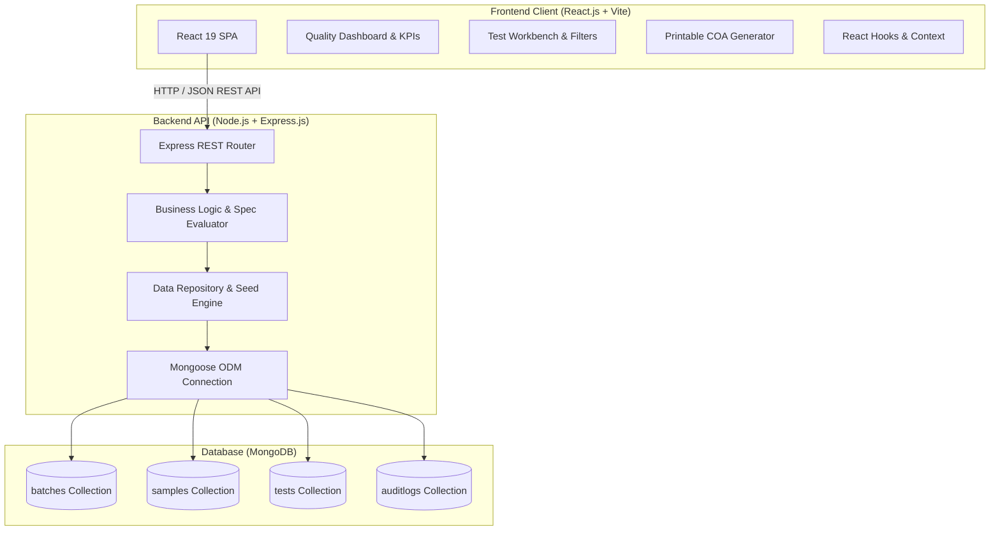
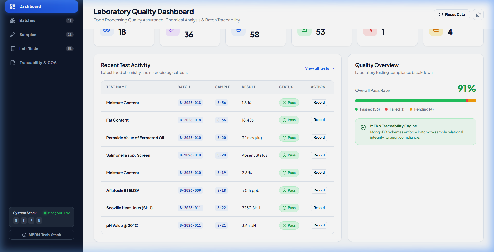
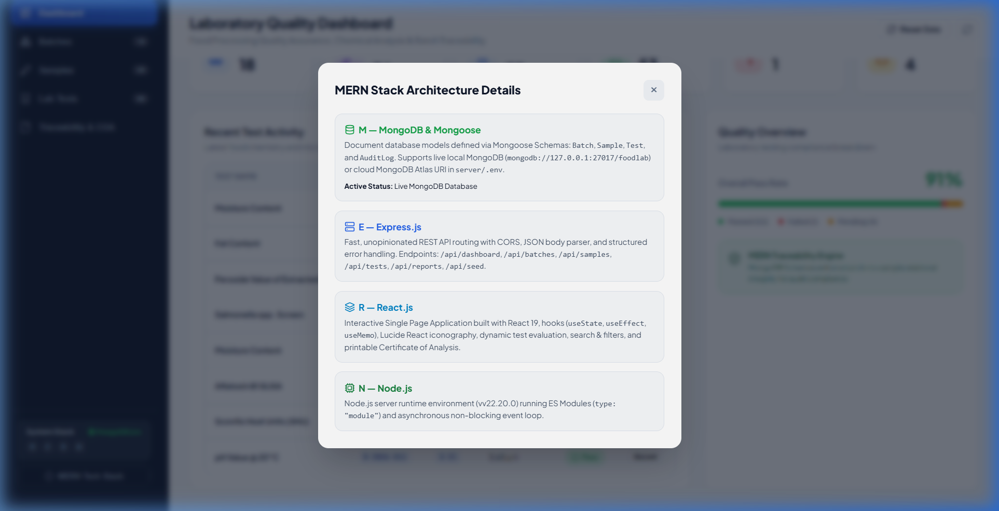
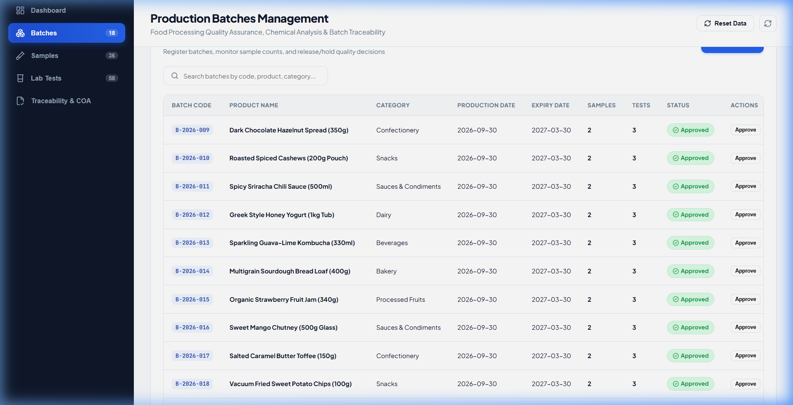
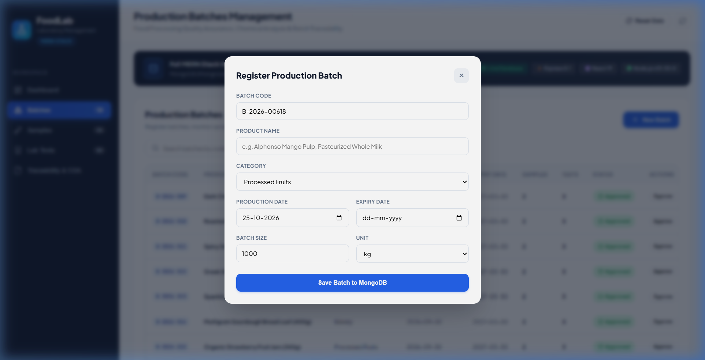
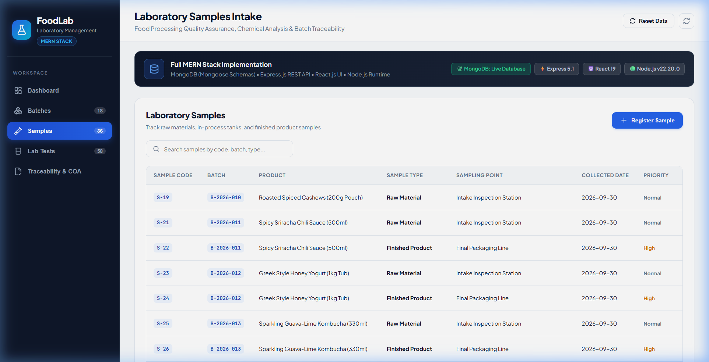
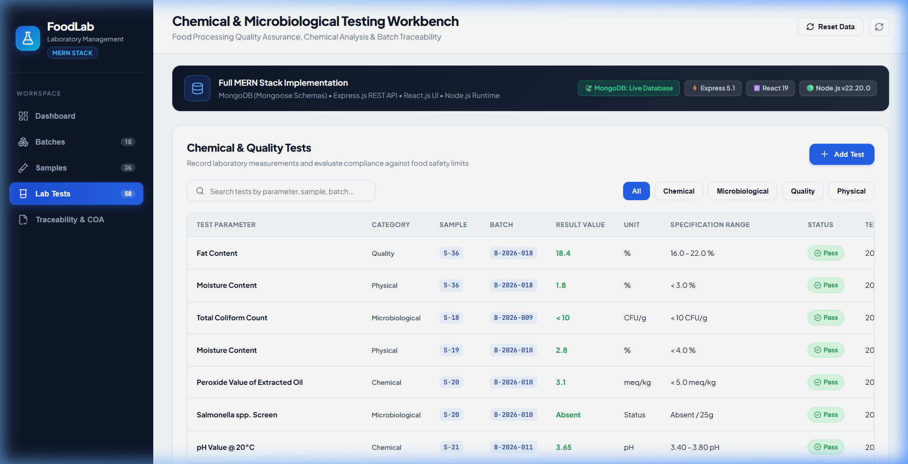
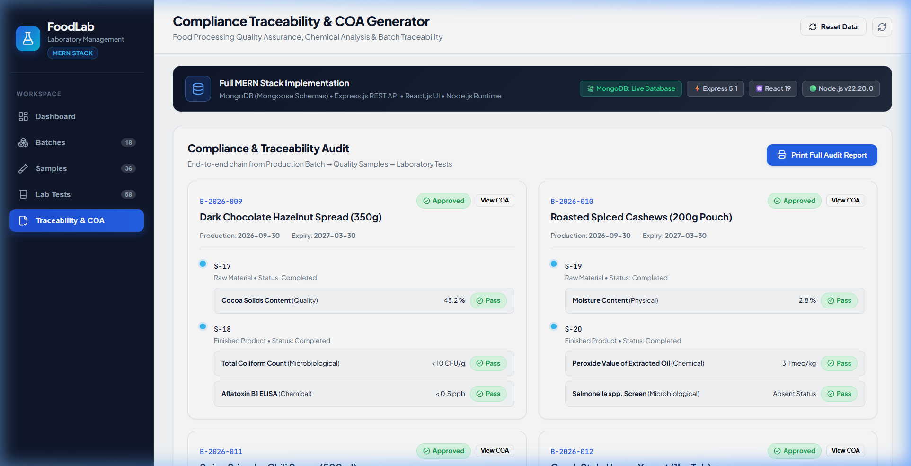
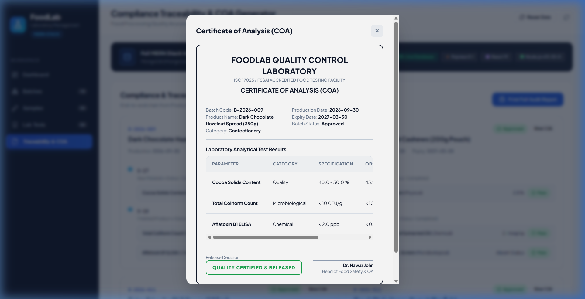

# 📋 PROJECT REPORT: FoodLab — Food Processing Laboratory Management System (MERN Stack)

**Project Title:** FoodLab — Food Processing Laboratory Quality Control & Traceability Management System  
**Academic Domain:** Full Stack Development (FSD) / Enterprise Web Application  
**Tech Stack:** MERN (MongoDB, Express.js, React.js, Node.js) + Vite + CSS Design System  
**Author / Lab Supervisor:** Dr. Nawaz John  

---

## 📑 Table of Contents
1. [Executive Summary](#1-executive-summary)
2. [Problem Statement & Motivation](#2-problem-statement--motivation)
3. [System Architecture & Tech Stack](#3-system-architecture--tech-stack)
4. [Database Modeling & Schemas](#4-database-modeling--schemas)
5. [RESTful API Design & Endpoints](#5-restful-api-design--endpoints)
6. [Core Modules & User Interface (With Screenshots)](#6-core-modules--user-interface-with-screenshots)
   - 6.1 [Executive Quality Dashboard](#61-executive-quality-dashboard)
   - 6.2 [MERN Architecture & Live Diagnostics](#62-mern-architecture--live-diagnostics)
   - 6.3 [Production Batches Management](#63-production-batches-management)
   - 6.4 [Batch Creation Workflow](#64-batch-creation-workflow)
   - 6.5 [Laboratory Sample Intake & Chain of Custody](#65-laboratory-sample-intake--chain-of-custody)
   - 6.6 [Chemical & Microbiological Testing Workbench](#66-chemical--microbiological-testing-workbench)
   - 6.7 [Traceability & Lineage Audit](#67-traceability--lineage-audit)
   - 6.8 [Accredited Certificate of Analysis (COA)](#68-accredited-certificate-of-analysis-coa)
7. [Automated Compliance Evaluation Logic](#7-automated-compliance-evaluation-logic)
8. [Installation & Deployment Guide](#8-installation--deployment-guide)
9. [Conclusion & Future Enhancements](#9-conclusion--future-enhancements)

---

## 1. Executive Summary

**FoodLab** is an enterprise-grade laboratory information management and compliance traceability system engineered specifically for food-processing facilities, quality assurance (QA) laboratories, and testing centers. 

Food safety regulations (such as **FSSAI, ISO 22000, HACCP, and ISO/IEC 17025**) mandate that food manufacturers track raw materials, intermediate processing phases, and final packaged goods with rigorous chemical, microbiological, and physical analysis. Traditional food processing facilities often rely on disconnected spreadsheets or manual logbooks, which risk clerical errors, data loss, delayed test turnaround, and failed safety audits.

FoodLab solves these bottlenecks by providing a unified **MERN Stack** web application where production batches are logged, laboratory samples are taken into custody, lab technicians enter analytical results with instant automatic specification pass/fail evaluation, and QA supervisors can generate and print accredited **Certificates of Analysis (COA)** with 1-click batch release or hold controls.

---

## 2. Problem Statement & Motivation

### The Challenge in Modern Food Manufacturing:
1. **Disjointed Traceability:** Food items undergo multi-stage transformations (raw agricultural goods $\rightarrow$ processing $\rightarrow$ pasteurization $\rightarrow$ packaging). Linking a microbiological failure in a packaged product back to its specific raw ingredient intake silo is extremely difficult without relational lineage.
2. **Delayed Specification Verification:** Technicians testing pH, Brix, Titratable Acidity, or microbial pathogens (*Salmonella*, *E. coli*, *Listeria*) historically checked reference tables manually, leading to human error in product release decisions.
3. **Audit Vulnerabilities:** Generating ISO 17025 compliant Certificates of Analysis (COA) takes hours to assemble manually during export or distribution compliance checks.

### The Solution:
FoodLab automates this end-to-end lifecycle:
- Instant ingestion of production batches and sample aliquots.
- Real-time specification bounds matching (numeric range checks and qualitative pathogen checks).
- One-click batch release workflow (Hold / Approved / Quarantined).
- Instant, audit-ready COA generation formatted for official print release.

---

## 3. System Architecture & Tech Stack

FoodLab is architected using a 3-tier decoupled model powered by the modern JavaScript/NoSQL ecosystem:



### Technology Breakdown:

| Layer | Technology | Version | Purpose |
|---|---|---|---|
| **Frontend** | **React.js** | 19.x | Modern functional components, hooks (`useState`, `useEffect`, `useMemo`), responsive laboratory UI. |
| **Build Tool** | **Vite** | 8.x | Lightning-fast HMR (Hot Module Replacement) and optimized bundling. |
| **Icons** | **Lucide React** | Latest | Vector iconography for laboratory and status telemetry. |
| **Backend API** | **Express.js** | 5.x | High-throughput RESTful routing, CORS handling, structured JSON error handling. |
| **Runtime** | **Node.js** | 22.x | High-performance asynchronous event-driven JavaScript server environment. |
| **Database** | **MongoDB** | 6.x+ | Scalable NoSQL document store with JSON schema flexibility. |
| **ODM Layer** | **Mongoose** | 9.x | Strict schema enforcement, virtual population, validation hooks, and pre-save triggers. |

---

## 4. Database Modeling & Schemas

The database uses MongoDB with Mongoose object data modeling. It establishes an interconnected relational lineage between **Batches**, **Samples**, and **Tests**.

### 1. Batch Entity (`Batch.js`)
Represents an entire manufactured lot of food products.
- `batchCode`: Unique alphanumeric identifier (e.g., `B-2026-001`).
- `productName`: Descriptive name (e.g., *Alphonso Mango Pulp Export Grade*).
- `category`: Enum (*Processed Fruits, Dairy, Beverages, Sauces & Condiments, Bakery, Confectionery, Snacks*).
- `productionDate` & `expiryDate`: Shelf life window.
- `batchSize` & `unit`: Batch volume (e.g., `5000 kg`, `12000 liters`).
- `status`: Enum (*In Testing, Approved, Hold, Rejected, Quarantined*).
- `supervisor`: QA lead signing off on batch safety (default: *Dr. Nawaz John*).

### 2. Sample Entity (`Sample.js`)
Represents physical specimens extracted at critical control points (CCPs).
- `sampleCode`: Unique identifier (e.g., `SMP-2026-001-A`).
- `batchId`: Foreign reference linking directly to the parent `Batch`.
- `sampleType`: Enum (*Raw Material, In-Process, Finished Product, Packaging, Environmental Swab*).
- `samplingPoint`: Physical plant location (e.g., *Silo #2, Filler Head #4*).
- `priority`: Enum (*Normal, High, Urgent*).
- `storageCondition`: Preservation parameters (e.g., *Refrigerated 4°C, Ambient*).
- `status`: Enum (*Pending, In Testing, Completed, Flagged*).

### 3. Test Entity (`Test.js`)
Represents laboratory assays performed on an ingested sample.
- `testName`: Chemical, physical, or microbiological parameter (e.g., *pH, Brix, TPC, Salmonella*).
- `category`: Enum (*Chemical, Microbiological, Quality, Physical, Sensory*).
- `resultValue`: Recorded value from laboratory equipment.
- `unit`: Unit of measurement (°Bx, pH, CFU/g, %, mg/kg).
- `specificationMin` & `specificationMax`: Numerical tolerance range.
- `specification`: Qualitative benchmark (e.g., *Absent in 25g*).
- `status`: Auto-calculated status (*Pending, Pass, Fail, Retest*).
- `analystName`: Certified lab technician responsible for the test.

### 4. Audit Log Entity (`AuditLog.js`)
Tracks operational compliance actions (batch status toggles, test revisions, database resets) to meet ISO 17025 audit compliance standards.

---

## 5. RESTful API Design & Endpoints

| Method | Endpoint | Description | Request / Response Payload |
|---|---|---|---|
| `GET` | `/api/health` | System health, MERN connectivity, Node version, and database mode | Returns connection status, uptime, server details |
| `GET` | `/api/dashboard` | Aggregated KPIs (Batches, Samples, Tests, Pass Rate, Recent activity) | JSON summary object with pass percentage & feeds |
| `GET` | `/api/batches` | List all registered batches with summary sample/test counts | Array of Batch documents |
| `POST` | `/api/batches` | Register a new production batch | Accepts batch code, product, category, size, dates |
| `PATCH` | `/api/batches/:id/status` | Update batch release status (Approved / Hold / In Testing) | Body: `{ status: "Approved" }` |
| `GET` | `/api/samples` | List all laboratory samples and their linked batch details | Array of Sample documents |
| `POST` | `/api/samples` | Create new sample aliquot under an active batch | Accepts sampleCode, batchId, sampleType, point |
| `GET` | `/api/tests` | Query lab test results with filtering support | Array of Test records with specification limits |
| `POST` | `/api/tests` | Add new test parameter and trigger automatic evaluation | Accepts testName, sampleId, result, specMin/Max |
| `PUT` | `/api/tests/:id` | Update test result, re-triggering automated status calculation | Updates resultValue and status |
| `GET` | `/api/reports` | Comprehensive batch traceability and COA dataset | Relational tree of Batch $\rightarrow$ Samples $\rightarrow$ Tests |
| `POST` | `/api/seed` | Reset and populate test dataset with standard food lab data | Resets database with 18 batches, 36 samples, 58 tests |

---

## 6. Core Modules & User Interface (With Screenshots)

### 6.1 Executive Quality Dashboard
The primary command center displays real-time key performance indicators (KPIs), overall compliance pass rates, recent production batches, and live analytical activity feeds.



- **Total Batches Tracked:** 18
- **Active Laboratory Samples:** 36
- **Tests Conducted:** 58
- **Overall Quality Pass Rate:** 91% (Visual progress indicator)
- **Recent Laboratory Activity Feed:** Immediate alerts on test results (e.g., Passed Brix and Titratable Acidity, Flagged Sodium levels).

---

### 6.2 MERN Architecture & Live Diagnostics
FoodLab contains an integrated diagnostic modal detailing active MERN architectural components and database connectivity.



- Confirms **MongoDB live connection status** with database URI and active document models.
- Outlines **Express.js API routing** and middleware pipeline.
- Documents **React 19 single-page application** component tree.
- Verifies **Node.js v22+ runtime** environment.

---

### 6.3 Production Batches Management
Allows plant managers and quality supervisors to register, monitor, and regulate manufacturing batches across categories like Processed Fruits, Dairy, Sauces, and Beverages.



- Dynamic search and filter by batch code or product name.
- Status badges: **Approved**, **In Testing**, **Hold**, **Quarantined**.
- One-click action buttons to switch status directly from the table.

---

### 6.4 Batch Creation Workflow
A guided registration modal ensures complete data integrity before a new batch enters production testing.



- Validation for unique batch codes and mandatory dates.
- Category selector and volume specification (kg / liters).
- Supervisor attribution and manufacturing notes.

---

### 6.5 Laboratory Sample Intake & Chain of Custody
Tracks specimens collected across every phase of the manufacturing process (Raw Material, In-Process, Finished Product, Environmental Swabs).



- Sample identification code with foreign batch linkage.
- Critical control point (CCP) sampling locations (e.g., *Aseptic Tank #2, Intake Silo #1*).
- Priority tags: **Normal**, **High**, **Urgent**.
- Storage condition requirements (*Cold chain 4°C, Frozen -18°C, Ambient*).

---

### 6.6 Chemical & Microbiological Testing Workbench
The central workspace for laboratory analysts to enter analytical test results, compare against strict regulatory thresholds, and trigger automated compliance flags.



- Category filter pills: *All*, *Chemical*, *Microbiological*, *Quality*, *Physical*.
- Displays standard target ranges (e.g., pH: 3.80 - 4.20, Total Plate Count: < 5000 CFU/g).
- Real-time **Pass / Fail** evaluation badge.
- Inline edit and record update capabilities.

---

### 6.7 Traceability & Lineage Audit
The compliance verification hub connects raw materials, intermediate processes, and finished batches into a unified audit tree.



- Visual summary of sample counts and test completion per batch.
- Batch compliance percentage.
- Direct **"View COA"** action to generate customer and regulator release certificates.

---

### 6.8 Accredited Certificate of Analysis (COA)
FoodLab generates formal, accredited release documentation formatted in accordance with **ISO/IEC 17025** and **FSSAI** laboratory reporting standards.



- Laboratory credentials: *ISO/IEC 17025:2017 & FSSAI Accredited Central Food Quality Assurance Facility*.
- Comprehensive sample metadata, sampling point, batch size, and dates.
- Detailed analytical results table with parameters, method references, specs, and status.
- Official QA release disposition: **CONFORMS TO SPECIFICATIONS — RELEASED FOR COMMERCIAL DISTRIBUTION**.
- Authorized electronic signature and direct browser print capability.

---

## 7. Automated Compliance Evaluation Logic

FoodLab implements automated business rules within both the Mongoose Schema layer (`Test.js`) and the frontend client to eliminate manual interpretation mistakes:

```javascript
// Automated Specification Checking Engine
testSchema.methods.evaluateStatus = function () {
  if (!this.resultValue) {
    this.status = 'Pending';
    return this.status;
  }

  // 1. Numeric Range Evaluation (e.g., pH, Brix, Moisture, Acidity)
  const numericVal = parseFloat(this.resultValue);
  if (!isNaN(numericVal)) {
    if (this.specificationMin !== null && numericVal < this.specificationMin) {
      this.status = 'Fail';
      return this.status;
    }
    if (this.specificationMax !== null && numericVal > this.specificationMax) {
      this.status = 'Fail';
      return this.status;
    }
    if (this.specificationMin !== null || this.specificationMax !== null) {
      this.status = 'Pass';
      return this.status;
    }
  }

  // 2. Qualitative / Microbiological Evaluation (e.g., Salmonella, Listeria)
  if (this.specification && this.specification.toLowerCase().includes('absent')) {
    const val = String(this.resultValue).toLowerCase();
    if (val.includes('detected') || val.includes('positive')) {
      this.status = 'Fail';
    } else {
      this.status = 'Pass';
    }
    return this.status;
  }

  this.status = 'Pass';
  return this.status;
};
```

---

## 8. Installation & Deployment Guide

### Prerequisites
- Node.js (v18.0.0 or higher, tested on v22.20.0)
- npm (v9.0.0 or higher)
- MongoDB (Local community instance or free MongoDB Atlas cluster)

### Step 1: Clone Repository
```bash
cd FoodLab_FSD_Project/FoodLab_FSD
```

### Step 2: Configure & Start Backend Server
```bash
cd server
npm install
```
Configure `server/.env`:
```env
PORT=5000
MONGODB_URI=mongodb://127.0.0.1:27017/foodlab
```
Launch backend:
```bash
npm run dev
```
*Backend initializes on `http://localhost:5000` with active MongoDB connection.*

### Step 3: Configure & Start Frontend Client
In a new terminal:
```bash
cd ../client
npm install
npm run dev
```
*Frontend opens at `http://localhost:5173`.*

---

## 9. Conclusion & Future Enhancements

### Key Achievements:
- Successfully implemented a high-performance, full-stack **MERN** architecture.
- Replaced paper/spreadsheet logs with a reactive, automated laboratory database.
- Implemented real-time specification evaluation engine for instant pass/fail feedback.
- Designed an accredited, printable Certificate of Analysis (COA) conforming to food regulatory standards.

### Proposed Future Enhancements:
1. **IoT Laboratory Equipment Integration:** Direct serial/USB telemetry from digital refractometers, pH meters, and spectrometers.
2. **Barcode / QR Code Label Printing:** Generating GS1-compliant 2D barcodes for rapid sample scanning in the cold storage warehouse.
3. **Role-Based Access Control (RBAC):** Granular permission tiers for Laboratory Technicians, Quality Supervisors, Plant Managers, and External Auditors with JWT authentication.
4. **Export to PDF & Excel:** Automated emailing of signed COAs to supply chain distributors upon batch approval.
